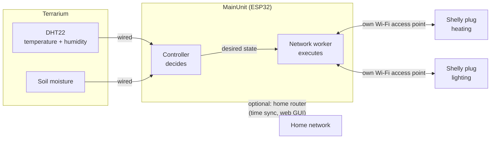
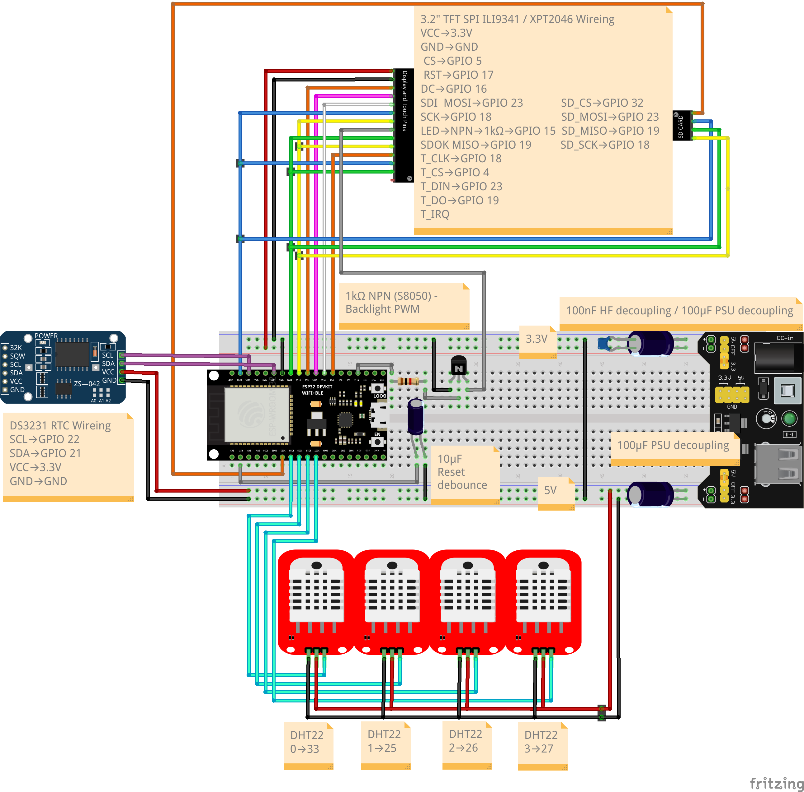

# TerraControl

*Smart terrarium control for those who don't want their setup
to stop working the day some company decides to shut down their
servers — and for those who need more than one or two plugs.
A work in progress measured in years, not sprints, with a parts budget that long surpassed the
price of the off-the-shelf box, not counting the ones that
released their magic smoke. And if this accidentally turns out
to be a solid foundation for a home automation system — well,
that was definitely not the plan.*

## In Short

TerraControl measures conditions inside a terrarium — temperature, humidity, soil moisture — and switches lighting, heating and irrigation accordingly. Everything runs locally on a small ESP32 microcontroller: no cloud account, no app subscription, no dependency on the home router.

Because animals depend on it, the system is built around one principle: **when something fails, it fails safe.** A broken sensor never triggers the heating, and if the controller itself stops working, every switched device turns itself off after a set time.

## Project Status

> **🚧 In the middle of a redesign.** The `main` branch builds and runs, but **it does not switch any devices at the moment.**

| | |
|---|---|
| **Works on `main`** | Firmware builds; local sensors (4× DHT22, soil moisture) are read and printed to the serial console; settings are stored in flash (NVS) |
| **Built, not yet wired up** | Device layer for Shelly smart plugs: relays and their measurements (power, energy, temperature), onboarding template for the Shelly Plug S Gen3 |
| **Being rebuilt next** | Network worker (talks to the plugs) and controller (makes the switching decisions) |
| **Earlier stage of this codebase** | Switched three Shelly plugs over the ESP32's own access point, see [manual test log](docs/integrationstests.md) |
| **Original prototype** *(separate codebase)* | Has been running a terrarium rack for over a year, switching a wired relay box. Long-term operation exposed two failures that shaped this redesign: an unreliable SD card reader (replaced by NOR flash) and DHT22 sensors that report a plausible 0.0 °C after losing power (now detected as invalid) |
| **Remote sensor node** *(prototype, [separate repo](https://github.com/lernenrocks/ESP32-C3_RemoteSensor))* | In use: an ESP32-C3 weighs the irrigation system's water tank (HX711 + load cell) and measures temperature and humidity (DHT22). Its web GUI runs on its own REST API — the same approach the MainUnit will use |

## How It Works



An ESP32 sits at the heart of the system as the **MainUnit**. It runs its own Wi-Fi access point, and the Shelly smart plugs connect directly to it — not to the home router. All device communication stays local. If the router goes down, the terrarium keeps running.

Sensors are wired to the MainUnit. The controller compares each measurement against its rule and decides whether a plug should be on or off. The network worker then makes the plugs match that decision.

**The failsafe:** every "on" command carries a timer. The plug switches itself off when the timer runs out, unless the MainUnit renews the command in time. The MainUnit only renews it while it has a fresh, valid measurement and the controller is still deciding. A crashed controller, a dead sensor or a lost Wi-Fi connection all end the same way: the plug turns off.

## Design Decisions

The interesting part of this project is less *what* it does and more *why* it is built this way. Some of these decisions are already in the code; the others are settled and are part of the network worker and controller rebuild. A selection:

- **Own access point instead of the home network.** The plugs live in an isolated network that only the MainUnit controls. No cloud, no exposure to the home network, no dependency on the router.
- **Devices are identified by MAC address, not IP.** IP addresses change. Before every request, the MainUnit looks up the device's current IP and checks the MAC in the response. A device that took over a recycled IP address cannot be switched by mistake.
- **Desired vs. reported state instead of a command queue.** The controller only states what it *wants* ("heating on"). The network worker compares that with what the plug *reports* and sends a command only if they differ. There are no queued commands that could pile up or arrive late. This is the same idea as device shadows in AWS IoT or openHAB's split of command and state.
- **No decision without a valid measurement.** A sensor that fails often still delivers a plausible-looking value. The prototype showed it: a DHT22 that loses its power supply keeps running parasitically over its data line, sends all-zero bytes with a valid checksum, and reports 0.0 °C — which would turn the heating on. Each sensor class checks its own failure patterns. When a value is invalid, the controller makes no decision and the failsafe takes over.
- **Built to run for months.** Microcontrollers have little memory, and repeatedly allocating and freeing memory at runtime slowly fragments it until the device crashes — typically after weeks. TerraControl allocates memory only on rare user actions (adding a device); recurring code paths use fixed buffers only.
- **Device and entity are separate.** A physical device (e.g. a power strip, with one set of credentials) holds several entities (four relays, power meters, a temperature sensor). Home Assistant and Zigbee2MQTT use the same split. A power strip is polled once, not once per socket.
- **Every value has exactly one writer.** The user sets the mode, the controller sets the desired state, the network worker records what the device reports. No two tasks ever write the same value, which makes the concurrency between tasks traceable.
- **Credentials are wiped from memory after use.** Passwords are read into a buffer right before use and overwritten right after, in a way the compiler cannot optimize away. This way they cannot show up in a crash dump.
- **Time is passed in, not fetched.** Decisions receive the current time as a parameter instead of reading the clock themselves. This keeps them testable without hardware, including the timer overflow after 49 days.

The full reasoning, including rejected alternatives and the date each decision was made, lives in [`CLAUDE.md`](CLAUDE.md) (German).

## Architecture

| Task | Core | Role |
|---|---|---|
| Controller + sensors (Arduino loop) | 1 | Reads sensors, applies rules, writes the desired state per relay |
| Network worker | 0 | Only place that talks to devices: switching, status polling, failsafe renewal |
| API worker *(planned)* | 0 | Web GUI and REST API, on both the access point and the home network |

| Module | Purpose |
|---|---|
| `ApDeviceRegistry` / `ApDevice` | Physical devices on the access point: identity, credentials, polling schedule |
| `EntityBase` → `ApDeviceRelayBase` → `ShellyGen2Relay` | Switchable outputs, manufacturer-specific part kept thin |
| `ApDeviceSensor` | Any measurement reported by a device (power, energy, temperature, …) |
| `SensorManager` / `SensorBase` | Locally wired sensors (DHT22, soil moisture) |
| `DigestAuth` / `HttpClient` | SHA-256 Digest Auth over a plain `WiFiClient`, no heap |
| `NvsStorage` | Persistent settings, mirrored in RAM |

## Roadmap

- [x] Shelly Gen2/3 control with SHA-256 Digest Auth *(prototype — being rebuilt on the new device layer)*
- [x] Soft-AP — plugs connect directly to the ESP32, isolated from the home network
- [x] `SensorBase` — DHT22 temperature/humidity and soil moisture on a shared, NVS-backed abstraction
- [x] Device/entity layer — `ApDevice`, relays, measurement entities, registry with lock, Shelly Plug S Gen3 template
- [x] Persistent storage — NVS with RAM mirrors, custom partition table
- [ ] **Network worker + controller** — desired/reported state reconciliation, failsafe renewal ← *next*
- [ ] Native unit tests for the device layer (fake NVS, no hardware needed)
- [ ] Remote sensors — ESP32-C3 nodes outside the terrarium, polled on demand *(node firmware runs as a [prototype](https://github.com/lernenrocks/ESP32-C3_RemoteSensor); MainUnit side pending)*
- [ ] RTC (DS3231) + local SNTP server — correct time without internet
- [ ] Switching rules — threshold with hysteresis, timed runs
- [ ] Web GUI + REST API
- [ ] JSON config export/import
- [ ] NOR flash logging
- [ ] Onboarding wizard — add a factory-reset Shelly without touching its app
- [ ] Monitoring — detect relays that don't follow, notify the user
- [ ] Own power consumption (INA219)
- [ ] Flash encryption

## Hardware

The MainUnit is headless: no display, no SD card. A web GUI — already proven on the remote sensor node — will be the only interface.

### MainUnit v1

| Component | Description | Quantity |
|---|---|---|
| ESP32 DevKit V1 | ESP32-WROOM-32D, 38-pin | 1 |
| Shelly Plug S | Smart Wi-Fi power plug, Gen2/3 | up to 10 (shared with remote sensor nodes) |
| DHT22 | Temperature and humidity sensor | up to 4 |
| Soil Moisture Sensor V1.2 | Capacitive, corrosion-resistant | 1 |
| DS3231 | I²C real-time clock with battery backup (LIR2032) | 1 |
| W25Q128 | SPI NOR flash, 16 MB, for logging | 1 or more |
| Breadboard | 830 holes | 2–3 |
| Dupont cables | Male-to-Male / Male-to-Female / Female-to-Female | assorted |
| USB cable | Micro-USB, for ESP32 power and flashing | 1 |
| USB power adapter | 5 V, min. 1 A | 1 |
| Coffee | Black, strong | ∞ |

### Planned

| Component | Purpose |
|---|---|
| ESP32-C3 Super Mini | Remote sensor node outside the terrarium, connected via Wi-Fi — prototype with HX711 + load cell and DHT22 in use, see [ESP32-C3_RemoteSensor](https://github.com/lernenrocks/ESP32-C3_RemoteSensor) |
| INA219 | Measures the system's own power consumption |



*[Download full diagram (PDF)](hardware/TerraControl_MainUnit_V1_bb.pdf)*

> **Outdated** — the wiring diagram predates the headless redesign and still shows the display. It may contain errors.

## Getting Started

> In its current state, TerraControl is a development build: it reads sensors and prints them to the serial console.

### Prerequisites
- [VS Code](https://code.visualstudio.com/) with the [PlatformIO](https://platformio.org/) extension
- ESP32 DevKit V1 (ESP32-WROOM-32D) and the hardware described above

### Build and flash

1. Clone the repository
   ```bash
   git clone https://github.com/lernenrocks/TerraControl.git
   ```
2. Copy the configuration template and fill in your credentials
   ```bash
   cp include/wifi_config.h.example include/wifi_config.h
   ```
3. Erase the flash once — the project uses its own partition table
   ```bash
   pio run -t erase
   ```
4. Build, flash and open the serial monitor
   ```bash
   pio run -t upload -t monitor
   ```

### Libraries
Installed automatically by PlatformIO:
- `northernwidget/DS3231`
- `adafruit/DHT sensor library`
- `bblanchon/ArduinoJson` (v6)

## Testing

- **Unit tests** run on the PC with GoogleTest, no hardware needed: `pio test -e native`. Coverage is still small (MAC address handling); tests for the device layer are next on the roadmap.
- **Integration tests** are manual, with real Shelly plugs. The [current checklist](docs/integrationstests.md) documents the prototype; a new one follows with the network worker.

## How This Project Is Developed

Decisions are written down before they are built: what was decided, when, why, and which alternatives were rejected. When facts change, decisions get revisited — and the old reasoning stays visible. Recurring mistakes are collected in [`learnings/`](learnings/) (German), so they can be recognized in the next project.

[Claude Code](https://claude.ai/code) (Anthropic) serves as a sparring partner: researching documented approaches in other projects, challenging architecture decisions, playing through failure scenarios, and reviewing code. The core classes I write myself, with Claude reviewing them. Claude implements smaller, clearly specified changes — refactorings, cleanups, tests — after I've approved the approach. The decisions are mine.

## Feedback
Questions and feedback are always welcome — feel free to open an issue.
Please note that this is a hobby project and response times may vary.

## Author
Andy / lernenrocks<br>
[www.lernen.rocks](https://lernen.rocks/)

## License
[MIT](LICENSE)
